# АгроМаркет API

Backend интернет-магазина «АгроМаркет». В лабораторной №5 API работал с локальными данными; в лабораторной №6 каталог и заявки переведены на PostgreSQL. Ниже сохранены материалы предыдущей лабораторной и добавлена актуальная документация проекта.

## Быстрый запуск проекта

Для лабораторной №6 требуется PostgreSQL и настроенная строка подключения в `.env` (см. раздел «Лабораторная работа №6»).

```bash
cd agromarket-server
npm install
npm run dev
```

React-приложение запускается отдельно из каталога `agromarket-react` командой `npm run dev`.

## Структура проекта

```text
agromarket-server/
├── data/
│   └── db.json                 # начальные данные для seed
├── db/
│   ├── schema.sql
│   ├── pool.js
│   ├── seed.js
│   └── lab6-queries.sql
├── middleware/
│   ├── logger.js
│   ├── validateOrder.js
│   └── errorHandler.js
├── routes/
│   ├── products.js
│   └── orders.js
├── postman/
│   └── agromarket.postman_collection.json
├── screenshots/
├── .env.example
├── server.js
├── package.json
└── README.md
```

## Лабораторная 5 — сохранённые материалы

Следующие заметки и скриншоты документируют выполненные ранее упражнения Express, middleware, CORS и работу формы. Описание хранения заявок в памяти относится к исходному этапу ЛР5; в текущей ЛР6 заявки сохраняются в PostgreSQL.

### Content-Type у res.send и res.json

- `res.send()` со строкой возвращает текстовый Content-Type: `text/html; charset=utf-8`.
- `res.json()` возвращает `application/json`.

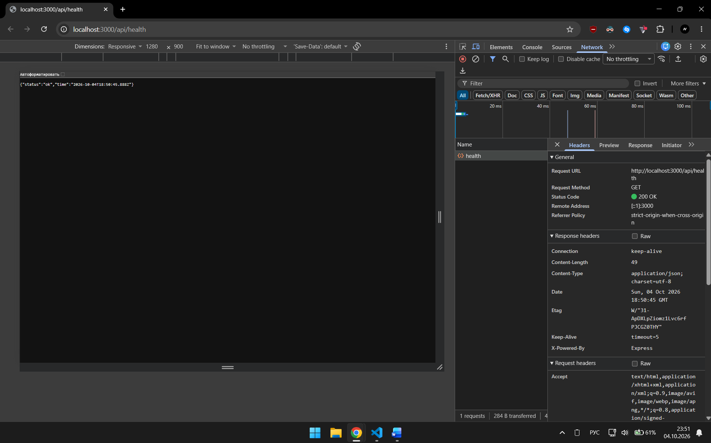

### Middleware и обработчик 404

- Middleware, который не вызывает `next()` и не отправляет ответ, останавливает обработку запроса.
- Если logger подключён после маршрутов, ответивший маршрут до него не доходит.
- После подключения обработчика 404 неизвестный адрес возвращает JSON-ошибку вместо HTML.

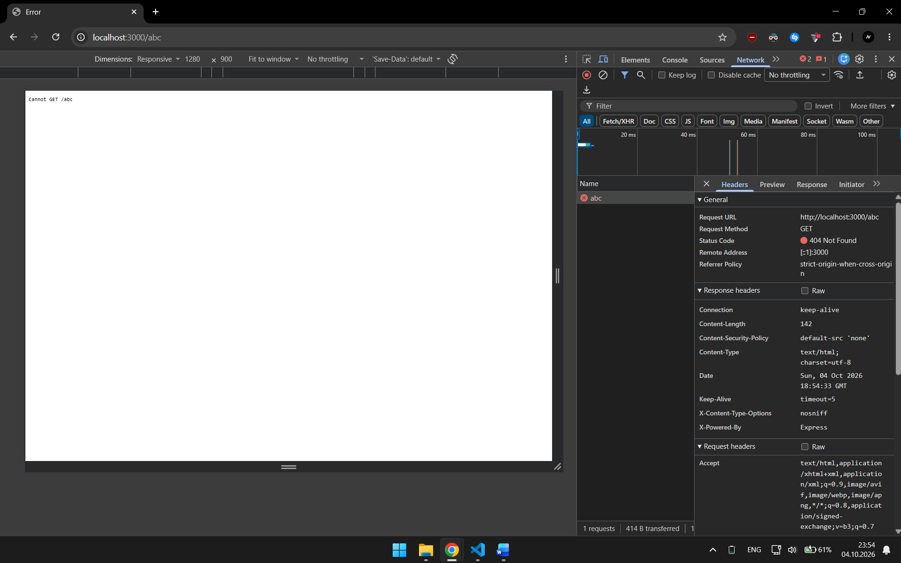

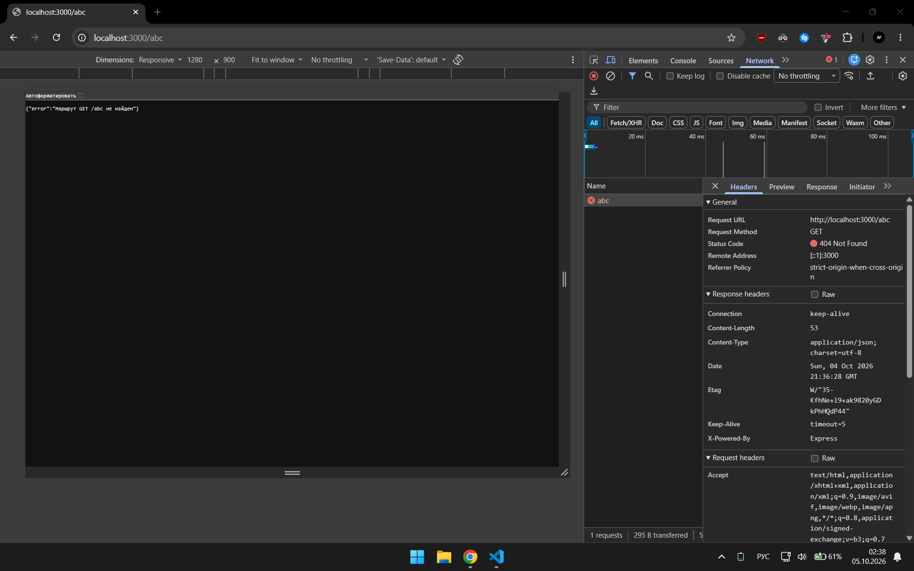

### CORS

- React работает на `localhost:5173`, Express — на `localhost:3000`; это разные origin.
- CORS разрешает браузеру читать ответы API.

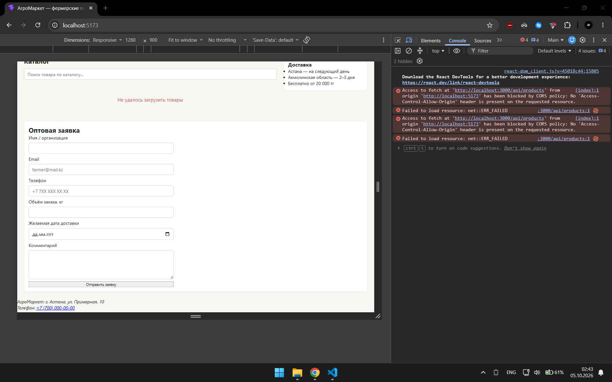

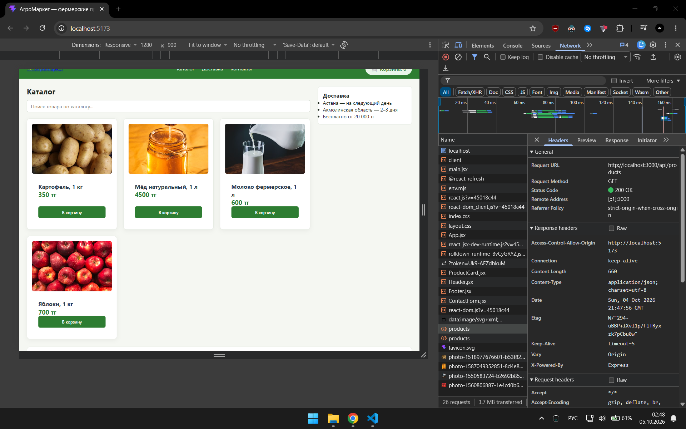

### Форма заявки и валидация в ЛР5

- При успешной отправке форма получала HTTP 201 и показывала номер заявки.
- Валидация проверяет обязательные `name`, `email`, `quantity` и минимальный объём 10 кг.
- `express.json()` разбирает JSON-тело запроса.

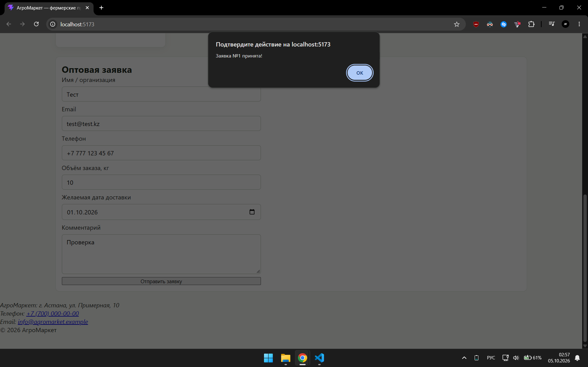

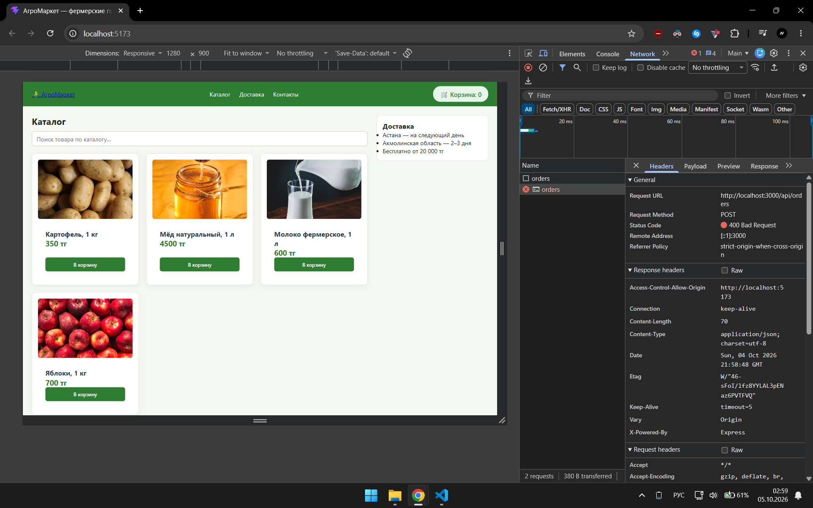

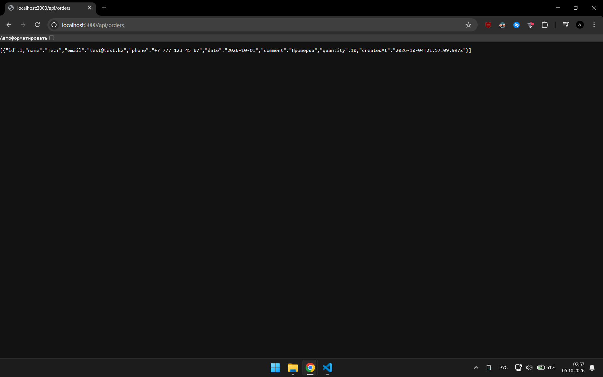

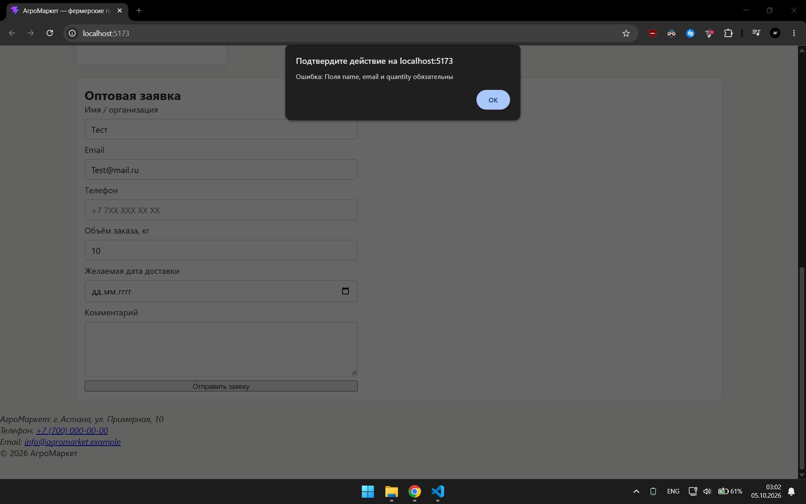

### Маршрутизаторы и бонусы ЛР5

- Маршруты товаров и заявок разделены между `routes/products.js` и `routes/orders.js`.
- В предыдущей версии выполнялись поиск `?search=`, фильтр `?maxPrice=`, сортировка `?sort=price` / `?sort=-price`, валидация заявки и блокировка кнопки формы на время отправки.

## Лабораторная работа №6 — PostgreSQL и CRUD API

### Цель и архитектура

Перевести хранение товаров и заявок из локальных структур в реляционную БД, реализовать SQL CRUD и связать каталог и форму React с API.

```text
React + Vite (localhost:5173)
          │ HTTP / JSON
          ▼
Express 5 API (localhost:3000)
          │ параметризованные SQL-запросы через pg
          ▼
PostgreSQL 18 (Ubuntu VMware)
```

В этой учебной конфигурации PostgreSQL запущен в Ubuntu VMware по адресу `192.168.174.10:5432`; база называется `agromarket`, пользователь — `agromarket_user`. Этот IP относится только к локальной виртуальной машине данного проекта. В другой сети, на другом компьютере или при использовании облачной БД значение `DATABASE_URL` необходимо настроить самостоятельно.

### Настройка и запуск

1. Запустить PostgreSQL в Ubuntu VMware и проверить, что кластер активен (например, `sudo systemctl start postgresql` и `pg_lsclusters`).
2. В каталоге `agromarket-server` создать `.env` на основе `.env.example`, затем указать актуальную строку подключения. Настоящий пароль хранить только в `.env`, не в README и не в Git.

   Пример формата (замените `<PASSWORD>` своим паролем локально):

   ```dotenv
   PORT=3000
   DATABASE_URL=postgresql://agromarket_user:<PASSWORD>@192.168.174.10:5432/agromarket
   CORS_ORIGIN=http://localhost:5173
   ```

   `.env` исключён из Git; `.env.example` содержит только пример настроек, без пароля.

3. Установить зависимости и запустить Express из `agromarket-server`:

   ```bash
   cd agromarket-server
   npm install
   npm run dev
   ```

   Альтернативная команда запуска: `npm start`. API доступен по адресу [http://localhost:3000](http://localhost:3000).

4. Запустить React в отдельном терминале:

   ```bash
   cd agromarket-react
   npm install
   npm run dev
   ```

   Vite обычно открывает frontend по адресу [http://localhost:5173](http://localhost:5173).

#### Первоначальная инициализация БД

Для пустой БД текущий `package.json` предоставляет команду:

```bash
npm run db:init
```

В методичке эта операция упоминается как `npm run db`, но в текущем проекте такой script **не определён**; фактическое имя — `db:init`. Команда запускает `db/seed.js`, создаёт таблицы и загружает исходные товары. Это только первоначальная инициализация пустой базы. Скрипт намеренно прекращает работу, если таблицы уже существуют; не запускайте его повторно на рабочей БД и не используйте как обычную команду старта сервера.

### Таблицы и ограничения

Схема находится в [`db/schema.sql`](./db/schema.sql).

| Таблица | Основные поля и ограничения |
| --- | --- |
| `products` | `id SERIAL PRIMARY KEY`, обязательные `name` и целочисленный `price`, `CHECK (price >= 0)`, `unit` со значением по умолчанию, необязательные `category` и `image`. |
| `orders` | `id SERIAL PRIMARY KEY`, необязательный `product_id` с внешним ключом на `products(id)` и `ON DELETE SET NULL`, обязательные `name`, `email`, `quantity`, `CHECK (quantity >= 10)`, необязательные телефон, дата доставки и комментарий, статус из `new`, `processing`, `done`, `cancelled`. |

Заявки сохраняют ссылку на товар, а `GET /api/orders` получает название через `LEFT JOIN`; заявки без связанного товара также остаются в выдаче.

### SQL и безопасность

В [`db/lab6-queries.sql`](./db/lab6-queries.sql) собраны примеры и упражнения:

- `SELECT` — чтение всех товаров и выбор отдельных полей;
- `WHERE` — фильтрация, в том числе вместе с условием цены;
- `ORDER BY` — сортировка результатов;
- `ILIKE` — поиск подстроки без учёта регистра;
- `GROUP BY`, `COUNT`, `AVG` — группировка и агрегаты;
- `INSERT`, `UPDATE`, `DELETE` — изменение данных с `RETURNING`.

В API значения пользователя передаются параметрами `pg` (`$1`, `$2` и т. д.), а не вставляются в SQL как текст. Для сортировки используется белый список колонок. SQL-файл содержит упражнения с транзакциями и `ROLLBACK`; их наличие не означает, что они были повторно запущены в ходе этой финальной проверки.

### API-маршруты

Успешные ответы со списками сохраняют массив JSON. Ошибки возвращаются объектом `{ "error": "..." }`.

| Метод | Путь | Назначение | Ответы |
| --- | --- | --- | --- |
| `GET` | `/` | Проверка доступности сервера | 200 |
| `GET` | `/api/health` | Проверка API и соединения с PostgreSQL | 200 |
| `GET` | `/api/about` | Информация о проекте | 200 |
| `GET` | `/api/products` | Список товаров с поиском, фильтром, сортировкой и пагинацией | 200, 400 |
| `GET` | `/api/products/:id` | Получить товар | 200, 400, 404 |
| `POST` | `/api/products` | Создать товар | 201, 400 |
| `PUT` | `/api/products/:id` | Полностью обновить товар | 200, 400, 404 |
| `DELETE` | `/api/products/:id` | Удалить товар | 204, 400, 404 |
| `GET` | `/api/orders` | Список заявок с `product_name` | 200, 400 |
| `POST` | `/api/orders` | Создать заявку | 201, 400 |
| `PATCH` | `/api/orders/:id` | Изменить статус заявки | 200, 400, 404 |

Примеры безопасных GET-запросов:

```text
GET http://localhost:3000/api/health
GET http://localhost:3000/api/products
GET http://localhost:3000/api/products?search=мол&maxPrice=1000&sort=-price&limit=2&offset=0
GET http://localhost:3000/api/products?sort=name
GET http://localhost:3000/api/orders
GET http://localhost:3000/api/orders?status=new
```

Допустимые параметры `GET /api/products`:

| Параметр | Поведение |
| --- | --- |
| `search` | Поиск названия без учёта регистра; специальные символы поиска обрабатываются как буквальный текст. |
| `maxPrice` | Максимальная цена включительно. |
| `sort` | `price`, `-price`, `name`, `-name`; неизвестное значение безопасно возвращает порядок `id ASC`. При равных ключах сортировки добавляется `id ASC`. |
| `limit` | Целое число от 1 до 100; по умолчанию `20`. |
| `offset` | Неотрицательное целое число; по умолчанию `0`. |

Для `GET /api/orders` необязательный `status` принимает только `new`, `processing`, `done` или `cancelled`. Без него возвращаются все заявки; неизвестное, пустое или повторяющееся значение даёт HTTP 400.

Создание заявки из формы React отправляет поля `name`, `email`, `phone`, `quantity`, `date`, `comment` и `product_id`. ID выбранного товара передаётся числом; если товар не выбран, передаётся `null`.

### Централизованная обработка ошибок

`middleware/errorHandler.js` подключён после маршрутов и 404 middleware. Он преобразует известные ошибки PostgreSQL (`22P02`, `23502`, `23503`, `23514`) и ошибки разбора JSON в JSON-ответ 400. Для остальных ошибок возвращается общее сообщение 500; детали и секреты клиенту не выдаются.

### Postman

Коллекция [`postman/agromarket.postman_collection.json`](./postman/agromarket.postman_collection.json) содержит **16 запросов и 48 проверок**. По результату предыдущего запуска коллекции все 48 проверок прошли, ошибок не было. Этот показатель относится к первоначальному набору Postman и **не включает отдельные проверки четырёх бонусов**.

Коллекция содержит изменяющие данные запросы (создание/обновление/удаление тестового товара и создание заявки). Запускайте её только на тестовой БД и учитывайте предупреждения/инструкции по очистке в описании коллекции. В API нет публичного маршрута удаления заявки.

### React и результаты проверок

React загружает каталог из `GET /api/products`, выполняет поиск в каталоге и отправляет форму в `POST /api/orders`. Форма позволяет выбрать товар; при получении заявки сервер объединяет данные товара по `product_id`.

Результаты проверок проекта:

- PostgreSQL доступен; безопасные `SELECT` подтвердили **4 товара и 0 заявок**.
- Отдельным `SELECT` подтверждено, что тестовая заявка с `id = 6` отсутствует.
- Проверки GET для health, каталога, поиска, сортировок, страниц и фильтра статуса прошли; ошибки валидации возвращаются в JSON.
- Ранее выполненный запуск Postman: 16 запросов, 48/48 проверок, 0 ошибок.
- Дополнительные проверки бонусов выполнялись отдельно и не включены в 48 тестов Postman.
- Для `agromarket-react` команды `npm run lint` и `npm run build` завершились успешно.

### Скриншоты лабораторной №6

Все ссылки ниже ведут на файлы в [`screenshots/`](./screenshots/).

| Доказательство | Скриншот |
| --- | --- |
| PostgreSQL cluster в Ubuntu | 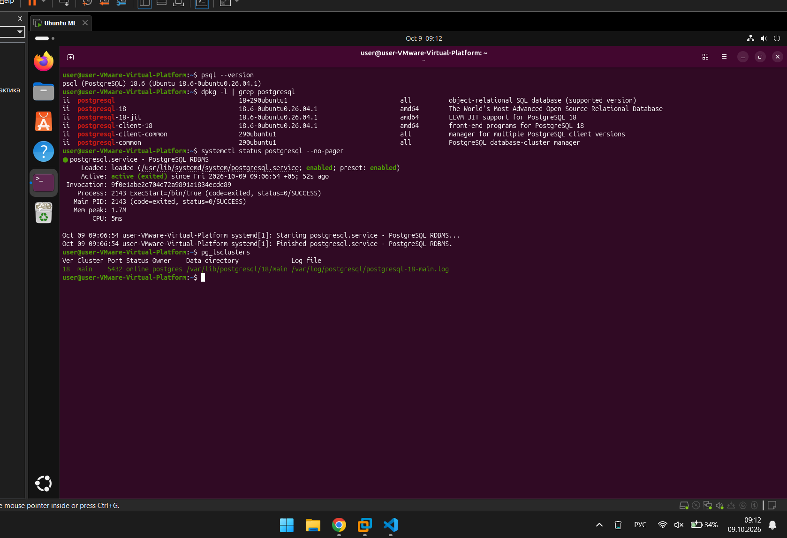 |
| Порт PostgreSQL | 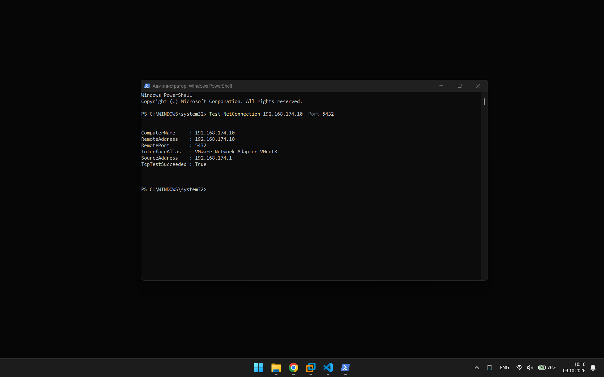 |
| Таблицы и товары в PostgreSQL | 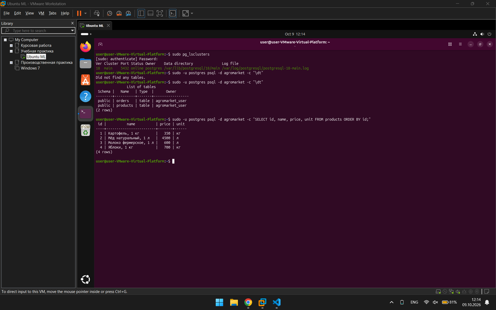 |
| SQL: фильтр и сортировка | 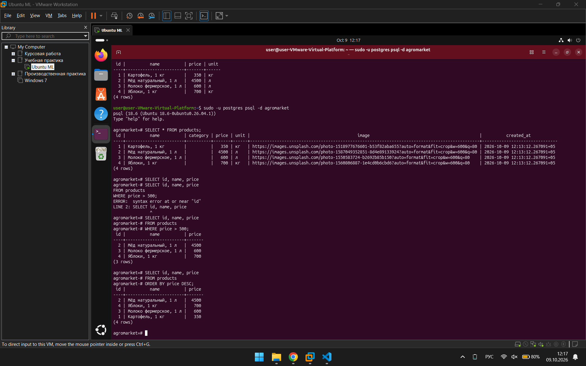 |
| SQL: поиск без учёта регистра | 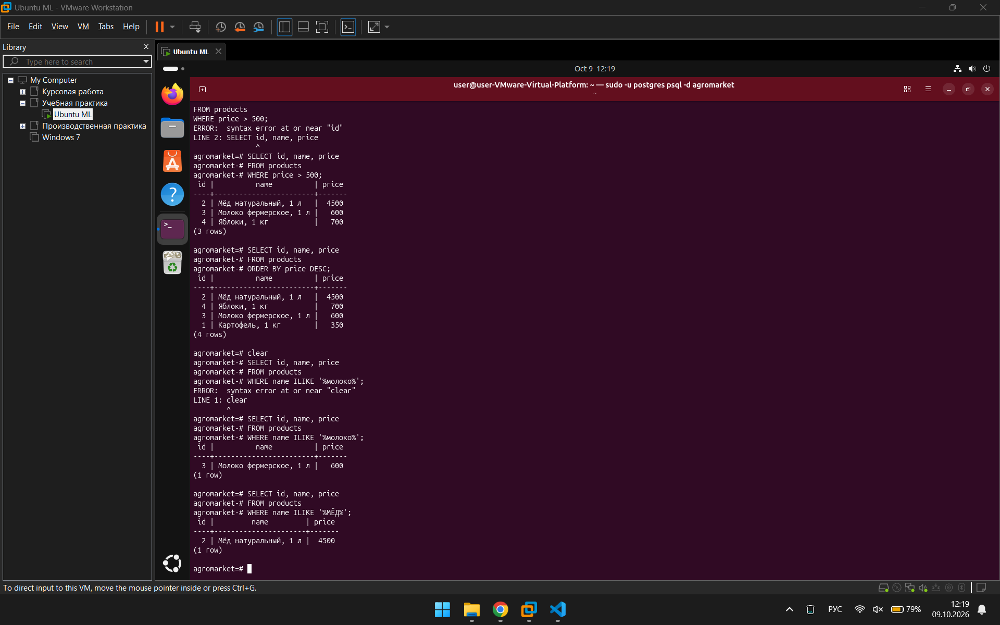 |
| Результаты SQL-упражнений | 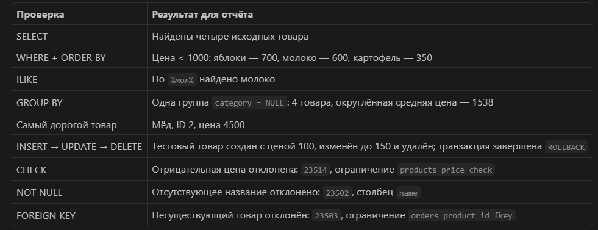 |
| API возвращает товары из PostgreSQL | 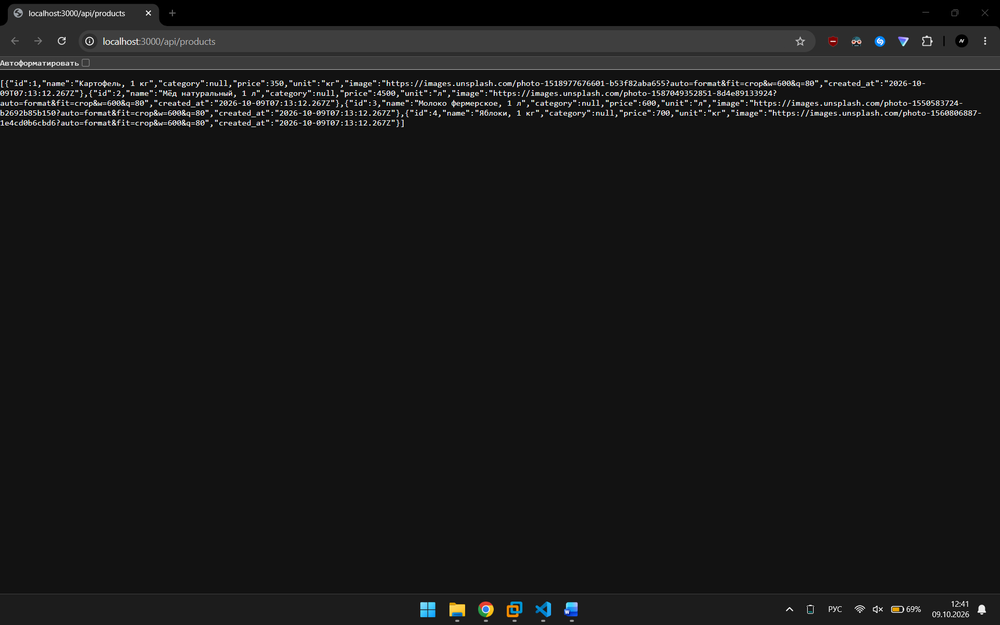 |
| Postman: состав коллекции | 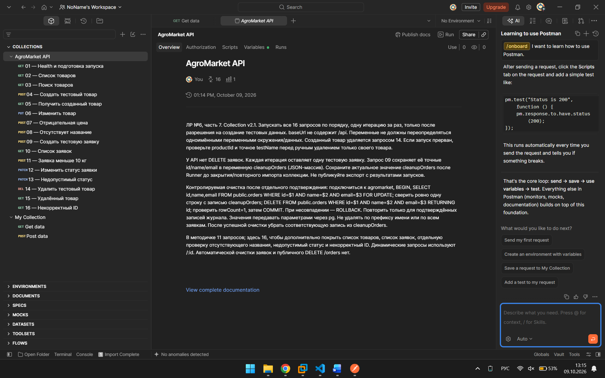 |
| Postman: успешные проверки | 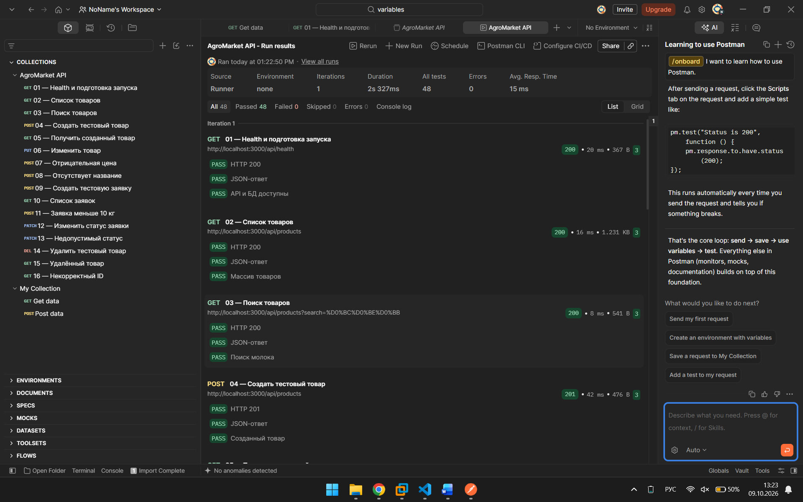 |
| Postman: проверки ошибок и CRUD | 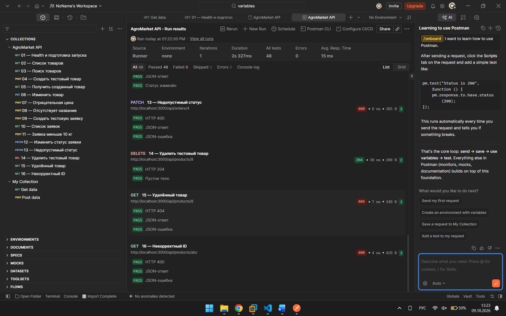 |
| Бонус: сортировка и пагинация | 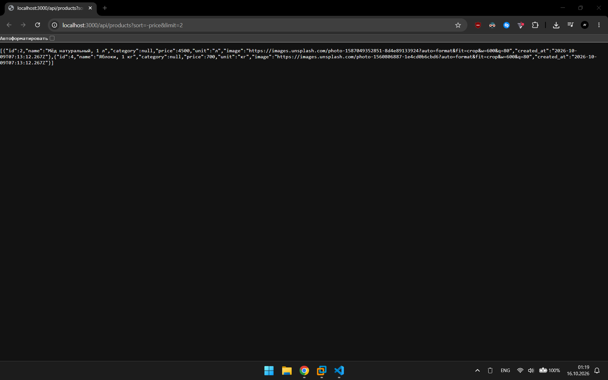 |
| Бонус: выбор товара в форме | 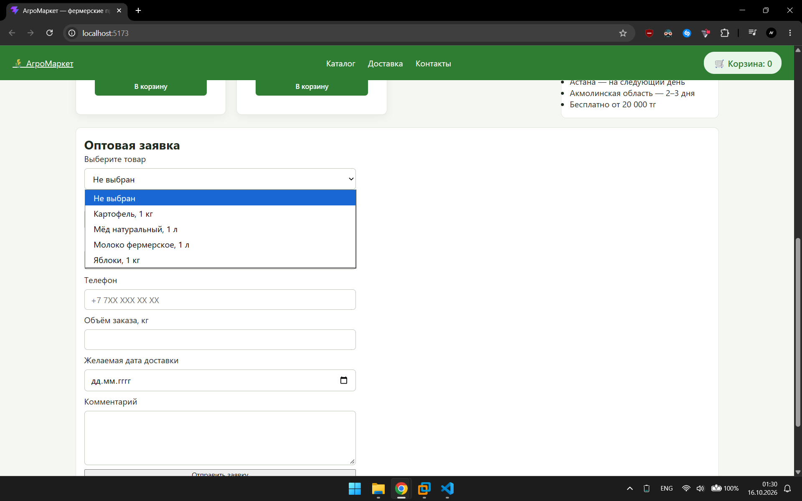 |

### Вывод

Каталог товаров и заявки хранятся в PostgreSQL; Express предоставляет параметризованный CRUD API и формирует JSON-ответы, React продолжает обращаться к API. Базовые и бонусные возможности проверены отдельно. На момент проверки в базе остаются четыре исходных товара и нет заявок.

### Использование ИИ

ИИ использовался для пошагового сопровождения лабораторных работ, проверки структуры проекта и объяснения Express, PostgreSQL, SQL, middleware, CORS и валидации. Ключевые результаты проверялись тестами, через API, браузер и Postman.

## Автор

Куанышулы Асылхан

## Лабораторная работа №7 — Пользователи и JWT

Цель работы — добавить учётные записи, безопасное хранение паролей,
JWT-аутентификацию и разграничение прав, сохранив каталог и заявки ЛР6.
Запросы идут по цепочке React → Express 5 → PostgreSQL 18 на Ubuntu VMware.
Этот раздел описывает текущее состояние проекта. Числа 16 запросов и 48 проверок выше
относятся к прежней коллекции ЛР6, а её открытые маршруты записи теперь защищены.
PostgreSQL 18 находится в Ubuntu VMware по адресу `192.168.174.10:5432`;
Express работает на основном компьютере на `localhost:3000`, React — на `localhost:5173`.

### Настройка и миграция

Установите зависимости командой `npm install`. В локальном `.env` задайте
`DATABASE_URL` с действующим адресом VM, `JWT_SECRET` (случайный секрет не короче
32 символов), `JWT_EXPIRES_IN=2h`, `ADMIN_EMAIL`, `ADMIN_PASSWORD` и
`CORS_ORIGIN=http://localhost:5173`. Формат без секретов приведён в
[`.env.example`](./.env.example). Не публикуйте `.env`, дампы или экспорт
окружения Postman.

Для уже существующей базы ЛР6 сначала создайте резервную копию на VM:

```bash
pg_dump -W -h 192.168.174.10 -p 5432 -U agromarket_user \
  -d agromarket -Fc -f "$HOME/agromarket-before-lab7.dump"
test -s "$HOME/agromarket-before-lab7.dump"
pg_restore -l "$HOME/agromarket-before-lab7.dump" >/dev/null
```

Затем один раз примените [`db/migrate-lab7-users.sql`](./db/migrate-lab7-users.sql)
из каталога, куда файл был скопирован на VM:

```bash
psql -W -X -v ON_ERROR_STOP=1 -h 192.168.174.10 -p 5432 \
  -U agromarket_user -d agromarket -f migrate-lab7-users.sql
```

Миграция выполняется в транзакции, создаёт `users` и добавляет необязательный
`orders.user_id` с `ON DELETE SET NULL`. Она не удаляет товары или заявки.
Таблица `users` содержит `id` (первичный ключ), обязательные `name`, уникальный
`email`, `password_hash`, роль `role` с допустимыми значениями `user` и `admin`
(по умолчанию `user`) и `created_at`. Пароль в открытом виде в БД не записывается:
при регистрации и смене пароля используется bcrypt с cost 10.
Повторный запуск завершится ошибкой существующей таблицы без потери данных.
Для новой пустой базы используется `npm run db:init`; для базы после ЛР6 эту
команду запускать нельзя. После миграции создайте администратора командой
`npm run db:admin`. Повторный запуск не создаёт дубль и не меняет пароль.

### Регистрация, вход и доступ к API

`POST /api/auth/register` проверяет обязательные имя, email и пароль длиной от
8 символов, нормализует email и всегда создаёт роль `user`. Повторный email
даёт 409. `POST /api/auth/login` сверяет пароль через `bcrypt.compare` и
возвращает профиль без `password_hash` вместе с JWT.

JWT подписывается `JWT_SECRET`, содержит `sub` и `role`, действует 2 часа.
Токен передаётся в заголовке `Authorization: Bearer <token>`.
`requireAuth` проверяет подпись и срок действия и помещает ID и роль в
`req.user`; `requireRole('admin')` ограничивает административные маршруты.
Отсутствующий или неверный токен даёт 401, недостаточная роль — 403.
`GET /api/auth/me` выбирает из PostgreSQL только `id`, `name`, `email`, `role`
и `created_at`; удалённый пользователь получает 401.

| Метод | Путь | Доступ |
| --- | --- | --- |
| `POST` | `/api/auth/register`, `/api/auth/login` | Публичный |
| `GET` | `/api/auth/me` | Авторизованный пользователь |
| `PATCH` | `/api/auth/password` | Авторизованный пользователь |
| `GET` | `/api/products`, `/api/products/:id` | Публичный |
| `POST`, `PUT`, `DELETE` | `/api/products`, `/api/products/:id` | Только admin |
| `POST` | `/api/orders` | Публичный; с JWT заявка связывается с пользователем |
| `GET` | `/api/orders/my` | Авторизованный пользователь, только свои заявки |
| `GET` | `/api/orders` | Только admin |
| `PATCH` | `/api/orders/:id` | Только admin |

Пароли хранятся как bcrypt-хэши с cost 10. `password_hash` не возвращается из
маршрутов авторизации. Вход ограничен пятью неудачными попытками с одного IP за
15 минут; следующая попытка получает 429. Helmet добавляет защитные заголовки,
CORS разрешает origin React, preflight `OPTIONS` и заголовок `Authorization`.
Размер JSON ограничен 16 КБ, превышение возвращает 413. Журнал не пишет тела,
заголовки и query-параметры запросов.

### Четыре бонуса

1. **Мои заявки:** `optionalAuth` разрешает гостевую заявку и связывает заявку
   авторизованного пользователя через `user_id`; `/api/orders/my` выбирает
   записи только по ID из JWT.
2. **Удаление товара:** администратор видит кнопку подтверждаемого удаления;
   каталог обновляется без перезагрузки страницы.
3. **Смена пароля:** `PATCH /api/auth/password` проверяет старый пароль, требует
   новый длиной не менее 8 символов и записывает только bcrypt-хэш.
4. **Панель заявок:** администратор видит список и меняет статус через
   `PATCH /api/orders/:id`.

### Postman Runner

В [`postman/agromarket.postman_collection.json`](./postman/agromarket.postman_collection.json)
сохранены прежние проверки ЛР6 и добавлены сценарии ЛР7. Выберите окружение
Postman и задайте в нём `userEmail`, `userPassword`, `adminEmail`,
`adminPassword`. Для регистрации на **изолированной тестовой БД** дополнительно
нужны `registerEmail` и `registerPassword`. Значения паролей и JWT не входят в
экспорт коллекции. Вход автоматически сохраняет `userJwt` и `adminJwt` в
переменные выбранного окружения; не экспортируйте это окружение с секретами.

Папку «ЛР7 — безопасная проверка доступа» можно запустить отдельно: она
проверяет 401/403/200 и не меняет таблицы. Перед запуском папок регистрации
или CRUD направьте отдельный backend на тестовую БД и только тогда установите
коллекционную переменную `allowWrites=true` (по умолчанию `false`). Старый CRUD
создаёт тестовую заявку, для которой в API нет удаления; не запускайте всю
коллекцию на рабочей базе. Подтверждённый запуск безопасной папки Runner:
**20 passed, 0 failed, 0 skipped, 0 errors**. Он проверял вход, публичный
каталог и границы 401/403/200; это не утверждение о выполнении всего CRUD на
рабочей базе.

### Ротация раскрытых секретов

Локальные снимки Postman с видимым паролем администратора, другими паролями
и JWT исключены из Git. Их нельзя публиковать. До сдачи:

1. Создайте новый уникальный пароль администратора (минимум 12 символов) в
   менеджере паролей и замените только `ADMIN_PASSWORD` в локальном `.env`.
2. Выполните `npm run db:admin:rotate`. Скрипт обновит bcrypt-хэш существующего
   администратора, не создавая нового пользователя. Не запускайте `db:admin`
   для ротации: он намеренно не сбрасывает пароль.
3. Смените пароль обычного пользователя, который был виден на снимках, через
   форму в React или `PATCH /api/auth/password` после входа этим пользователем.
4. Выполните `npm run jwt:rotate`. Команда создаст случайный `JWT_SECRET` в
   локальном `.env` и не напечатает его.
5. Перезапустите Express. Все старые JWT станут недействительными. Очистите
   прежние токены в Postman и браузере, войдите заново. Снимайте новые кадры
   с закрытыми полями пароля и токена.

Пароль администратора и `JWT_SECRET` уже ротированы владельцем проекта.
Команды описаны для следующей плановой ротации; старые снимки с секретами
остаются исключёнными из Git.

### Ответы по теме методички и использование ИИ

- bcrypt хранит односторонний хэш с солью, поэтому сервер сравнивает пароль
  через `bcrypt.compare`, не извлекая исходный пароль из БД.
- Подписанный JWT позволяет проверить подлинность и срок действия. `sub`
  указывает ID пользователя, `role` — его права. Подпись не шифрует payload,
  поэтому пароль и секрет в токен не помещаются.
- 401 означает отсутствие действительной авторизации; 403 — действительный
  токен с недостаточной ролью. Проверки выполняются middleware до SQL-запроса.
- `localStorage` сохраняет сеанс после F5, а `/api/auth/me` подтверждает его
  актуальность. При 401 frontend удаляет токен. Для более строгой защиты от
  XSS в производственной системе потребовалась бы отдельная модель хранения
  с HttpOnly cookie и CSRF-защитой.
- ИИ использовался для реализации и проверки SQL, маршрутов, интерфейса и
  тестов. Результаты проверок подтверждались локальными командами; новые
  операции записи на рабочей БД для тестирования не выполнялись.

Файл методички ЛР7 в репозиториях не обнаружен; выше приведены ответы на
вопросы по перечисленным требованиям, без утверждения о дословном составе методички.

### Подтверждения и границы проверки

Существующие снимки без видимых секретов:

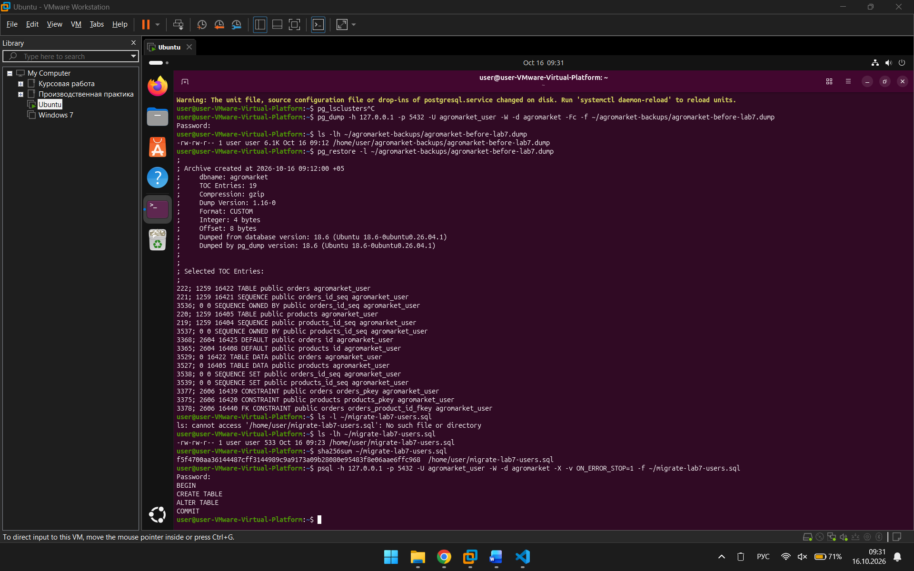
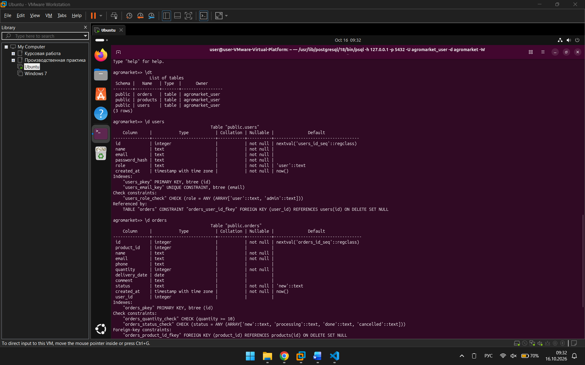
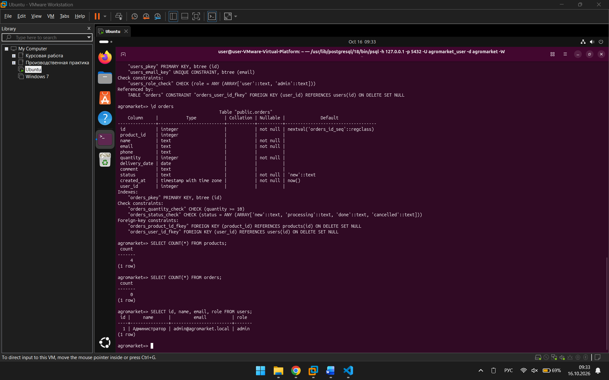
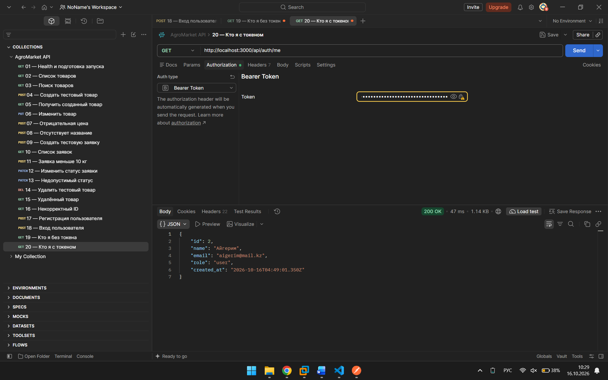
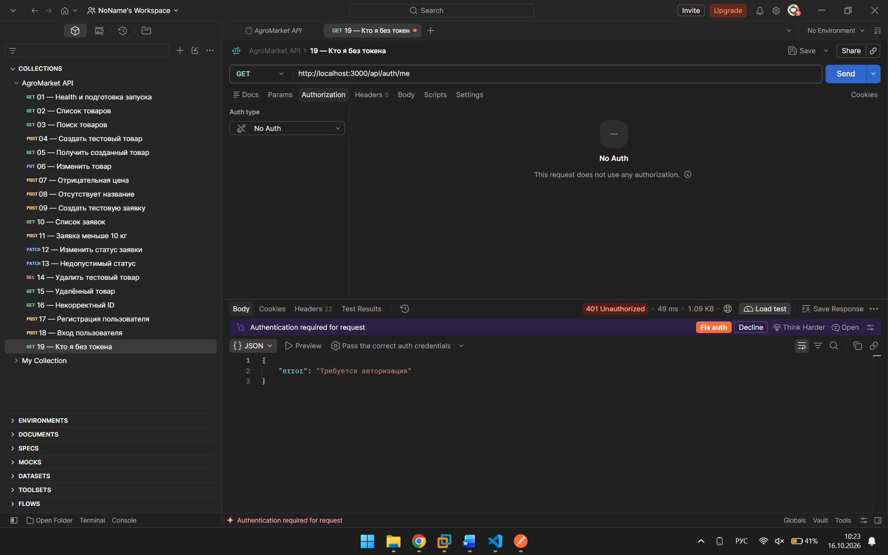
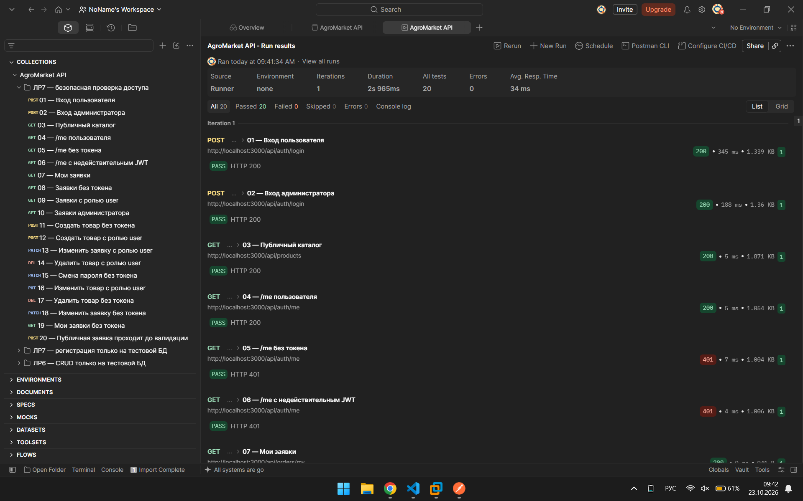
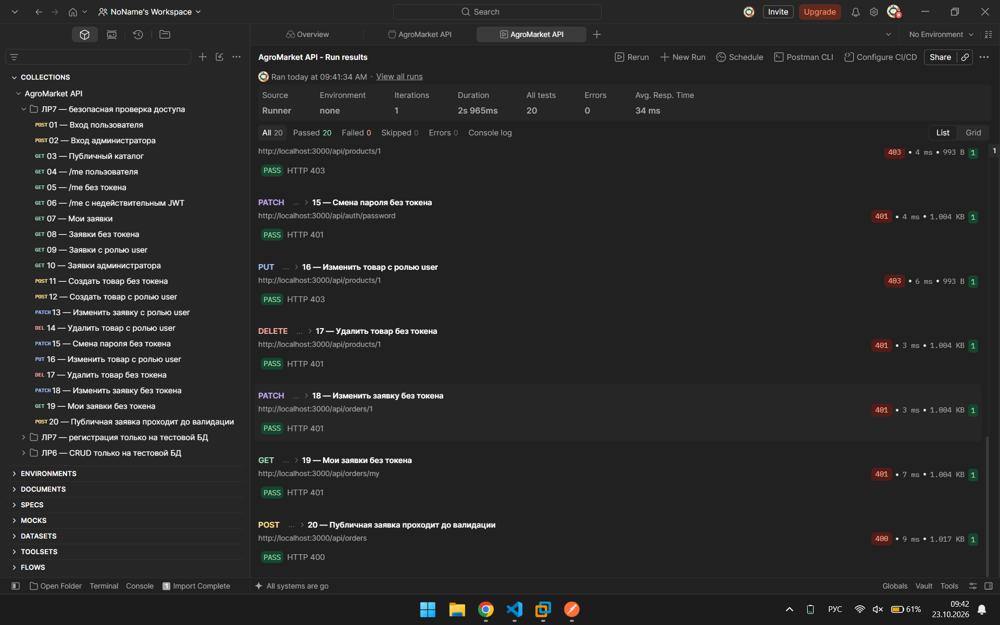

Старые снимки входа и регистрации с открытыми паролями или JWT намеренно не
включены. Backend-тесты с моками прошли: 3 из 3. `npm run lint` и `npm run build`
frontend также прошли. Изменяющие CRUD-проверки на рабочей БД не запускались.

## Lab 8: tests, CI, and Git workflow

### Run the API tests

Use PostgreSQL 16 or newer and create a dedicated database named `agromarket_test`. Copy `.env` to `.env.test`; keep the existing VMware host, port, user, and password, changing only the database name. The test setup verifies both the configured database name and PostgreSQL's `current_database()` before `db:init` can reset the test schema. `db:init` refuses every database except `agromarket_test`. For this VMware setup, `pg_hba.conf` must also permit `agromarket_user` from the Windows host (192.168.174.1) to `agromarket_test`; duplicate the existing working `agromarket` rule with only the database name changed, then reload PostgreSQL.

```bash
npm ci
npm test
npm run test:watch
npm run coverage
```

Coverage reports are written to `coverage/` and are ignored by Git. The latest verified local report is recorded in the Lab 8 results below.

### GitHub Flow and commits

Create a `feature/...` or `fix/...` branch from `main`, make focused changes, run tests, and open a Pull Request. Merge after CI passes and a reviewer approves; use Squash and merge. Protect `main` with a required Pull Request, one approval, the `test` status check, and blocked force pushes.

Use Conventional Commits, for example `feat: add product search`, `fix: return 404 for missing order`, `test: auth and access control`, `refactor: split app.js and server.js`, `ci: run tests in GitHub Actions`, and `docs: testing and git workflow in README`.

### Lab 8 answers

- Admin-role regression: the passing access tests cover no token (401), invalid JWT (401), and a regular user. If `requireRole` is removed only from `POST /api/products`, the regular-user create assertion is the one expected to fail (it receives 201 instead of 403); `requireAuth` still enforces 401. The deliberate code-removal experiment was not performed.
- Coverage: **Lines 69.86%, Statements 67.24%, Branches 56.55%, Functions 80.64%**. `routes/orders.js:30` is uncovered because no test sends an invalid `status` query to the administrator order-list route. `middleware/logger.js` is 0% by design: the app skips request logging when `NODE_ENV=test`.
- The `requireRole` unit test calls one middleware function with `vi.fn()` mocks and no HTTP server or database. `access.test.js` sends HTTP requests through Express, JWT verification, route middleware, and PostgreSQL.
- Code-review feedback received: **fill after your partner reviews the PR**.
- Comments left on the partner's PR: **fill after you review the partner's PR**.
- AI was used to prepare implementation and tests. Results above distinguish completed checks from blocked integration tests.

### Local experiment record

- Backend `npm test`: **32 passed, 0 failed** (3 existing `node:test` checks and 29 Vitest cases).
- Backend `npm run coverage`: **29 passed, 0 failed**; Lines 69.86%, Statements 67.24%, Branches 56.55%, Functions 80.64%.
- Red CI experiment: use a temporary feature branch, make one test expectation fail, confirm the check is red and merge is blocked, then restore the expectation and confirm the check is green. Do not leave the failing test in the final branch.
- Frontend checks: `npm run lint`, `npm run build`, and `npm test`.

For the real collaborator review, branch protection, and safe merge-conflict exercise, see [the Lab 8 GitHub steps](./docs/lab8-github-manual.md).
## Скриншоты ЛР8

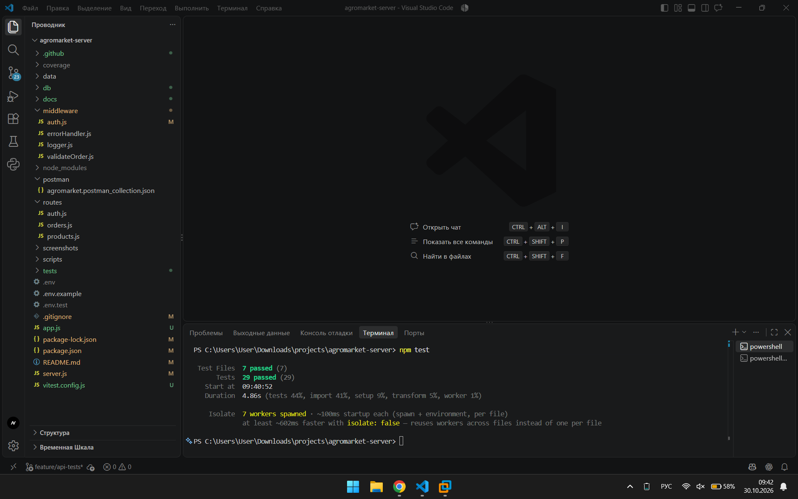
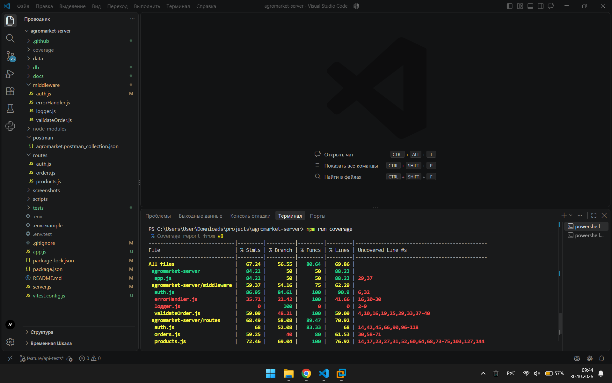
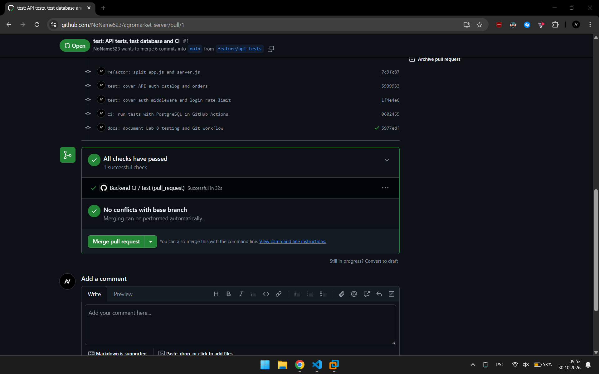
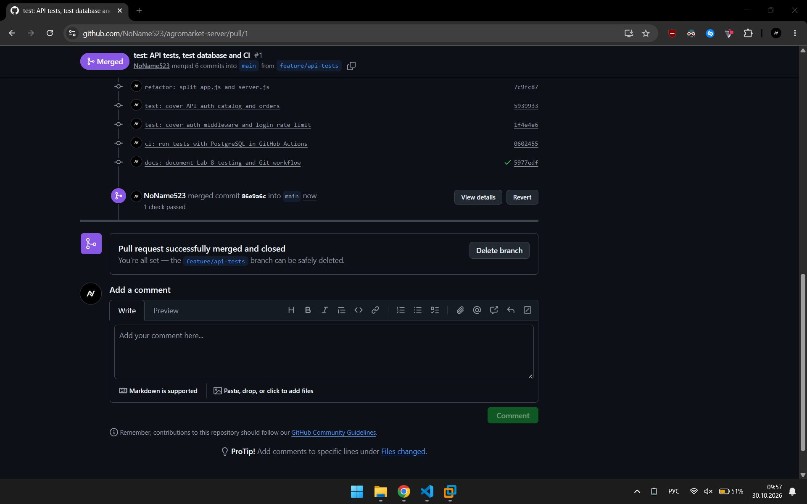